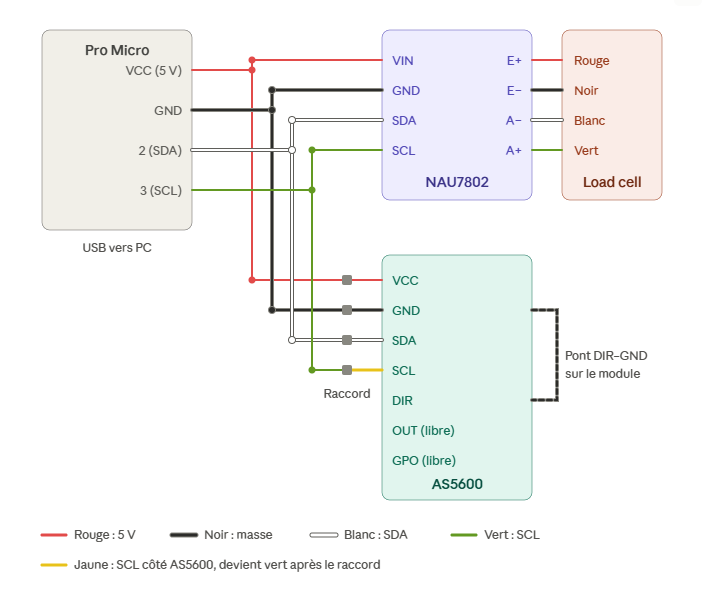

# Pédalier DIY — firmware + plugin SimHub

Pédalier de simracing fait maison : accélérateur à capteur magnétique **AS5600**, frein à **load cell** lue par un **NAU7802** (24 bits), sur une **Arduino Pro Micro**. Windows le voit comme une manette « Pedalier DIY », sans pilote. Tous les réglages se font depuis **SimHub** et sont enregistrés dans le pédalier : il garde ses réglages SimHub fermé.

## Installation (utilisateur)

1. Télécharge **`User.PedalierDIY.dll`** dans la [dernière release](https://github.com/XRockzen/SimHub-Pedalier/releases/latest).
2. Ferme SimHub et copie la DLL dans le dossier de SimHub (souvent `C:\Program Files (x86)\SimHub`).
3. Lance SimHub, accepte d'activer le plugin, puis ouvre **Pédalier DIY** dans le menu de gauche.
4. Branche le pédalier : le voyant passe au vert. Fais la calibration (onglet **Calibration**), puis **Enregistrer dans le pédalier**.

### Mises à jour

- **Plugin** : au démarrage de SimHub, un bandeau propose la nouvelle version. Clique **Installer**, puis redémarre SimHub.
- **Pédalier** : quand un nouveau firmware est publié, le bandeau (ou l'onglet **Diagnostic**) propose **Mettre à jour le pédalier**. Le firmware est écrit par le câble USB en une vingtaine de secondes ; les réglages enregistrés sont conservés. Si ça échoue, relance : le pédalier ne risque rien.

## Fonctions

| Onglet | Contenu |
|---|---|
| En direct | Valeur brute, calibrée et envoyée au jeu, pour chaque pédale |
| Calibration | Assistant 0 % / 100 %, mesure du pic du frein, valeurs à la main, linéarisation de l'accélérateur |
| Réglages | Courbe de réponse à la souris (+ préréglages), zones mortes, lissage, hystérésis, filtres du frein, re-tare |
| Profils | Jeux de réglages sur le PC, export / import |
| Diagnostic | Aimant, fréquences de mesure, erreurs, versions et mises à jour |

Propriétés SimHub (dashboards, overlays) : `PedalierPlugin.Accelerateur`, `PedalierPlugin.Frein` (en %), `…Calibre`, `…Brut`, `PedalierPlugin.Connecte`, `PedalierPlugin.CapteursOK`.

## Matériel

| Élément | Référence | Bus | Achat |
|---|---|---|---|
| Microcontrôleur | Pro Micro 5 V / 16 MHz (ATmega32u4), USB-C | USB | [Amazon](https://www.amazon.fr/dp/B0D69JLJ97) |
| Accélérateur | Module AS5600 12 bits + aimant (lot de 4) | I2C 0x36 | [Amazon](https://www.amazon.fr/dp/B0D4YW7NVB) |
| ADC du frein | Module NAU7802 24 bits, Stemma QT / Qwiic (format Adafruit 4538 : VIN 3-5 V, régulateur intégré) | I2C 0x2A | [Amazon](https://www.amazon.fr/dp/B0FYLL3CC3) |
| Capteur du frein | Load cell Mavin NA151, alliage d'aluminium, 100 kg, 4 fils | via NAU7802 | [AliExpress](https://fr.aliexpress.com/item/1005004043359730.html) |



Détails : [cahier des charges](docs/CAHIER_DES_CHARGES.md) · [protocole série](docs/PROTOCOLE.md).

## Développement

```
firmware/Pedalier/        firmware définitif (Pedalier.ino)
firmware/Pedalier_Diag/   croquis de validation du matériel (statistiques de bruit)
firmware/carte/           carte Arduino « Pedalier DIY » (nom USB, PID 0x80F0)
firmware/build_firmware.ps1   compile le .hex sans l'IDE
plugin/                   plugin SimHub (C# 5, .NET Framework 4.8)
plugin/build.ps1          compile le plugin avec le MSBuild de Windows (-Deploy : copie dans SimHub)
plugin/tools/render_ui.ps1    rendu hors écran des onglets (vérification sans SimHub)
release.ps1               publie une version (plugin + firmware) sur GitHub
```

- **Carte Arduino** : copier `firmware/carte/pedalier` dans `Documents\Arduino\hardware\`, redémarrer l'IDE, choisir « Pedalier DIY (Pro Micro 5V) ». Bibliothèques : *Joystick* (MHeironimus) et *SparkFun Qwiic Scale NAU7802*.
- **Plugin** : aucun Visual Studio nécessaire, `plugin\build.ps1` utilise le MSBuild livré avec Windows.
- **Publier** : `.\release.ps1 -Version x.y.z -Notes "..."`. Penser à augmenter `FW_VERSION` dans `Pedalier.ino` quand le firmware change, et `CFG_VERSION` si le format des réglages change (le plugin sauvegarde et restaure alors les réglages pendant la mise à jour).

La mise à jour du firmware utilise [avrdude](https://github.com/avrdudes/avrdude) (GPL-2.0), joint tel quel à chaque release.
